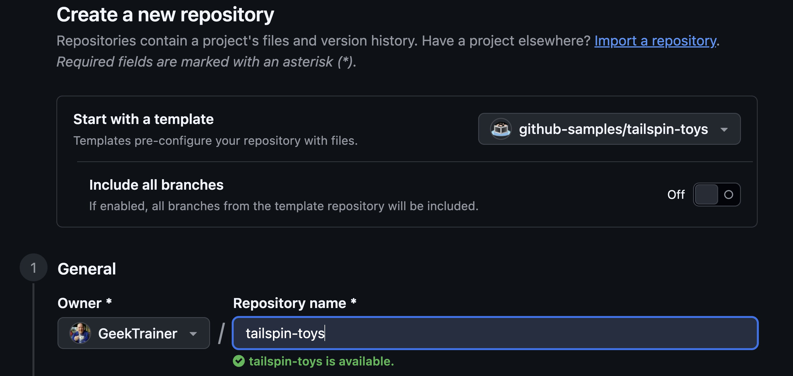

La aplicación GitHub Copilot es una aplicación de escritorio que sirve como centro de operaciones para Copilot y GitHub. Proporciona acceso rápido a incidencias y solicitudes de incorporación de cambios y permite desarrollar con GitHub Copilot. Durante este taller trabajarás en local con la aplicación Tailspin Toys, creada con Astro, mediante la aplicación GitHub Copilot. Antes de empezar, comprueba que Node.js esté instalado localmente y, después, instala la aplicación Copilot.

En esta lección:

- instalarás Node.js para que las pruebas del proyecto se puedan ejecutar en tu equipo;
- crearás tu propia copia del proyecto Tailspin Toys a partir de la plantilla.

## Instala Node.js

En varias lecciones se pedirá a un agente que implemente funcionalidades y ejecute en local el conjunto de pruebas de Tailspin Toys, para lo que se necesita **[Node.js][nodejs]**, el único entorno de ejecución que requiere el proyecto. Instala la versión **LTS** actual.

La opción más sencilla en cualquier plataforma es el instalador oficial:

1. Abre un terminal en tu sistema operativo, por ejemplo, Windows Terminal, Terminal de macOS o la aplicación que utilices habitualmente.
2. Ejecuta estos comandos para comprobar las versiones instaladas de Node.js y npm:

    ```shell
    node --version
    npm --version
    ```

3. Si ambos comandos se ejecutan correctamente y Node.js cumple los requisitos del README y de `package.json` del proyecto, puedes pasar a la sección siguiente.

> [!TIP]
> Solo tienes que completar estos pasos si no tienes Node instalado o si necesitas actualizarlo.

4. Abre la [página de descarga de Node.js][node-download].
5. Descarga la versión **LTS** para tu sistema operativo.
6. Ejecuta el instalador y acepta las opciones predeterminadas. En Windows, mantén seleccionada la opción **Add to PATH**.
7. Cuando termine la instalación, abre un terminal nuevo.
8. Confirma la instalación desde ese terminal:

    ```bash
    node --version
    npm --version
    ```

9. Deberían aparecer las versiones instaladas de Node.js y npm.

> [!IMPORTANT]
> El agente de la aplicación Copilot también debe poder ejecutar `node --version` y `npm --version`. Que funcionen en tu terminal habitual no garantiza que estén disponibles en la aplicación. Cierra completamente la aplicación y vuelve a abrirla después de instalar Node.js o cambiar `PATH`. Si alguno de los comandos sigue fallando en una sesión, sigue los [pasos para solucionar problemas del entorno de la sesión][session-environment] antes de continuar.

> [!IMPORTANT]
> Cada worktree también necesita las dependencias del proyecto y Chromium de Playwright para las comprobaciones E2E. Sigue el README del repositorio de Tailspin Toys al preparar un worktree y revisa cualquier solicitud de instalación antes de aprobarla.

## Configura el repositorio del laboratorio

Trabajarás con tu propia copia del proyecto Tailspin Toys. Créala ahora a partir del [repositorio de plantilla][template-repository]. El nuevo repositorio contiene todos los archivos necesarios para el laboratorio y lo conectarás cuando instales la aplicación.

1. En una nueva ventana del navegador, abre el repositorio de GitHub del laboratorio: `https://github.com/github-samples/tailspin-toys`.
2. Crea una copia del repositorio seleccionando el botón **Use this template** en la página del repositorio del laboratorio. Después, selecciona **Create a new repository**.

    

3. Si participas en un evento organizado por GitHub o Microsoft, sigue las instrucciones de los mentores. De lo contrario, puedes crear el repositorio en una organización a la que tengas acceso con GitHub Copilot.

    

4. Anota la ruta del repositorio que has creado (**organization-or-user-name/repository-name**), ya que la necesitarás más adelante en el laboratorio.

> [!NOTE]
> Al crear el repositorio a partir de la plantilla, se generará automáticamente un backlog de incidencias de GitHub. Trabajarás con estas incidencias durante todo el taller; no tienes que crear ninguna.

Usa una copia nueva de la plantilla del taller. Incluye instrucciones del repositorio, el código de la aplicación, pruebas, una habilidad `quality-checks` y una extensión de canvas existente. Durante el taller personalizarás la habilidad y crearás un agente de control de calidad (QA). Si usas una copia antigua, consulta con la persona que imparte el taller para confirmar que contiene los archivos necesarios.

## Resumen y próximos pasos

Ya tienes el entorno preparado. En esta lección:

- has instalado Node.js para compilar y probar el proyecto en tu equipo;
- has creado tu propia copia del repositorio Tailspin Toys a partir de la plantilla.

A continuación, [instalarás la aplicación GitHub Copilot][next-lesson], conectarás el repositorio y conocerás el espacio de trabajo.

## Recursos

- [Descargar Node.js][node-download]
- [Crear un repositorio a partir de una plantilla][template-repository]
- [Acerca de la aplicación GitHub Copilot][about-copilot-app]

[next-lesson]: ../1-install-copilot-app/
[nodejs]: https://nodejs.org/
[node-download]: https://nodejs.org/en/download
[template-repository]: https://docs.github.com/repositories/creating-and-managing-repositories/creating-a-template-repository
[about-copilot-app]: https://docs.github.com/copilot/concepts/agents/github-copilot-app
[session-environment]: ../3-agent-modes/#inicia-una-sesion-desde-la-incidencia
